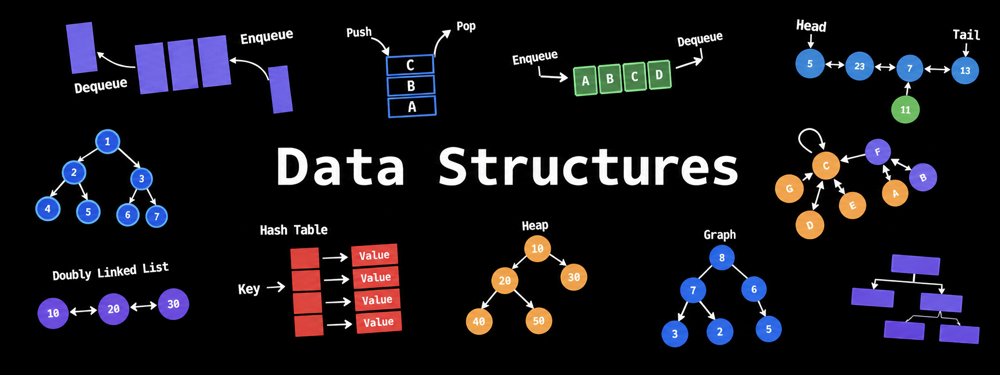

# Data Structures & Algorithms 



[](https://github.com/notdgx/data-structures)
[](https://notdgx.github.io/data-structures/)
[](https://c4knowledgeseekers.in/practice/data-structures)
[](#topic-breakdown)
[](#overview)

A complete practical repository and static multi-page website presenting implementations of fundamental **Data Structures and Algorithms** in C developed for the **BCA 2nd Year (Semester 3)** curriculum.

---

## Student & Course Information

- **Student:** Daisy Dhiman
- **Roll No:** 4205/25 (Section A)
- **Class / Semester:** BCA 2nd Year, Semester 3
- **Submitted To:** Mr. Chetan Gupta
- [Live Website](https://notdgx.github.io/data-structures/)
- [Assignment Questions](https://c4knowledgeseekers.in/practice/data-structures)
- [GitHub Repository](https://github.com/notdgx/data-structures)

---

## Overview

This repository contains **146 C implementations** covering classical data structures and algorithms, accompanied by:
- A clean, minimal,static multi-page website (`index.html` and `web-pages/`).
- Verified execution terminal outputs for each completed assignment question recorded in `output.json` and `output.md`.
- Core standalone implementations of custom data structures (Stacks, Queues, Linked Lists, Trees, Graphs).

---

## Key Metrics

- **Total Solved Questions / Programs:** `146`
  - **125** Syllabus Assignment Questions (organized by topic with source code & verified terminal outputs)
  - **21** Core Data Structure Implementations (`DATA STRUCTURES (self)`)
- **Total Git Commits:** `61`
- **Total Tracked Repository Files:** `164`

---

## Project Structure

```
data-structures/
├── index.html                   # Main landing page for the assignment website
├── README.md                    # Project documentation & overview
│
├── web-pages/                   # Dedicated HTML pages for each topic
│   ├── single-dimensional-arrays.html
│   ├── strings.html
│   ├── recursion.html
│   ├── multi-dimensional-arrays.html
│   ├── stacks.html
│   ├── queues.html
│   ├── linked-list.html
│   ├── trees.html
│   ├── graphs.html
│   ├── searching-algorithms.html
│   ├── sorting-algorithms.html
│   ├── data-structures.html     # Combined "DATA STRUCTURES (self)" page
│   └── style.css
│
├── notes/                       # Diagrams, images, and conceptual notes
│   ├── data-structure-ref.png   # Hero banner image for website & README
│   └── graph_traversal.html     # Interactive graph traversal visualization
│
├── website-questions/           # 125 assignment questions and execution database
│   ├── q-XX-YY.c                # C source code files (q-<topic_idx>-<que_num>.c)
│   ├── output.json              # JSON database of question texts, code, and terminal outputs
│   ├── questions.md             # Complete question syllabus checklist
│   ├── question_d.md           # Progress tracker with completion status (✅ / ❌)
│   ├── update_question_d.py     # Script to sync question completion status
│   └── bin/                     # Compiled executables for test runs
│
├── stack-questions/             # Self-implemented stack programs (Array & LL based)
├── queue/                       # Self-implemented queue programs (Linear & Circular)
├── linked-list/                 # Linked list implementations (Singly, Doubly, Circular)
├── trees/                       # Binary Search Tree implementation
├── graphs/                      # Adjacency matrix & graph traversal (BFS / DFS)
└── sorting-algorithms/          # Sorting implementations (Bubble, Insertion, Merge, Quick)
```

---

## Topic Breakdown

### 1. Syllabus Assignment Questions (`website-questions/`)

| # | Topic | Questions Solved | Highlights & Concepts |
| :-: | :--- | :-: | :--- |
| **01** | **Single-Dimensional Arrays** | 20 | Traversal, Reversal, Copy, Even/Positive filters, Min/Max, K-th smallest, Duplicates removal, Palindromes, Merging sorted arrays, Trapping Rain Water problem |
| **02** | **Strings** | 29 | Case conversions (Upper, Lower, Title, Sentence, Toggle), Palindrome checks, ASCII conversions, Substring search, Word / space counts, Permutations, Lexicographical sorting, Dictionary operations |
| **03** | **Recursion** | 8 | Factorial, Fibonacci series, Sum of natural numbers, Power calculations, Tower of Hanoi |
| **04** | **Multi-Dimensional Arrays** | 7 | Matrix input/display, Addition, Subtraction, Scalar/Matrix multiplication, Matrix transpose |
| **05** | **Stacks** | 5 | Integer & character stack with array, Dynamically allocated node stack, Bracket matching (`{}`) |
| **06** | **Queues** | 6 | Simple queue (integer & string arrays), Dynamic linked-list queue, Circular queue |
| **07** | **Linked List** | 8 | Singly linear, Singly circular, Doubly linear, Doubly circular lists with insert, delete, search, display |
| **08** | **Trees** | 8 | Tree reconstruction (Preorder+Inorder, Postorder+Inorder), Level-order traversal, Left/Right views, Max depth calculation, Dynamic BST, Node counts |
| **09** | **Graphs** | 4 | Adjacency matrix representation, Adjacency list, Depth-First Search (DFS), Breadth-First Search (BFS) |
| **10** | **Searching Algorithms** | 10 | Linear Search (arrays, strings), Binary Search (iterative and recursive) |
| **11** | **Sorting Algorithms** | 20 | Selection Sort, Bubble Sort, Insertion Sort, Merge Sort, Quick Sort (various orderings & sub-arrays) |

### 2. Core Custom Implementations (`DATA STRUCTURES (self)`)

Contains 21 standalone, modular implementations across:
- **Stacks (`stack-questions/`):** Fixed-size array stack, Multi-bracket matching (`{[()]}`), Next-pointer dynamic stack, Previous-pointer TOP-optimized stack, Polish notation converter & evaluator.
- **Queues (`queue/`):** Array-based linear queue, Dynamic linked-list linear queue, Circular linked-list queue, Array queue operations.
- **Linked Lists (`linked-list/`):** Complete implementations of Singly Linear, Doubly Linear, Singly Circular, and Doubly Circular linked lists with full CRUD operations.
- **Trees (`trees/`):** Dynamic Binary Search Tree with insertion, deletion, min/max, search, level count, and recursive traversals.
- **Graphs (`graphs/`):** Directed Graph with adjacency matrix, dynamic vertex addition/removal, edge toggling, neighbor degrees, BFS, and DFS.
- **Sorting Algorithms (`sorting-algorithms/`):** Bubble Sort, Insertion Sort, Merge Sort (multi-pass and recursive), Quick Sort.

---

## Automation & Workflow Tool: `qrun`

The repository includes a dedicated workflow CLI tool, [`website-questions/qrun`](website-questions/qrun), designed to streamline question compilation, interactive terminal capture, and progress tracking.

### What `qrun` Does

1. **Interactive Session Capture:** Compiles `q-NN-KK.c` into `./bin/q-NN-KK.out` and executes it inside a pseudo-terminal (using `script`) to capture real-time user inputs and program outputs.
2. **Database Logging (`output.json` & `output.md`):** Automatically registers the source code, captured terminal output, execution timestamps, exit codes, and SHA-256 code checksums.
3. **Automated Progress Tracking:** Triggers `update_question_d.py` after each run to mark the question as completed (`✅`) in `question_d.md`.
4. **Git Staging:** Automatically stages the source file, `output.md`, and `output.json` in Git.

---

### How to Use `qrun`

Navigate to the `website-questions/` directory:

```bash
cd website-questions
```

#### 1. Compile, Run & Log a Question
To compile, execute interactively, and log any question:
```bash
./qrun q-00-01.c
```
- Compiles the program to `./bin/q-00-01.out`.
- Runs the program interactively in your terminal.
- Captures inputs and program outputs into `output.json` and `output.md`.
- Automatically marks the question `✅` in `question_d.md`.

#### 2. Run an Already-Built Executable
Log an existing binary against its source file:
```bash
./qrun --run q-00-01.c -- ./bin/q-00-01.out
```

#### 3. Synchronize / Refresh Metadata
Scan all `q-*.c` files and refresh question headers, descriptions, and code checksums across all records:
```bash
./qrun --sync
```

---

### Environment Requirements
- **OS:** Linux / WSL
- **Compiler:** `gcc` (or set custom compiler via `CC=clang`)
- **Dependencies:** `python3` and `util-linux` (`script` command for terminal capture)

---

## Related Repositories

- [python-learning](https://github.com/notdgx/python-learning)
- [numpy-learning](https://github.com/notdgx/numpy-learning)
- [C_Questions](https://github.com/notdgx/C_Questions)
- [CPP_Questions](https://github.com/notdgx/CPP_Questions)

---

## License & Academic Integrity

This codebase is created for academic coursework and assignment submissions under BCA Semester 3 (Data Structures). All code comments, logic, and implementations adhere to academic coursework guidelines.


